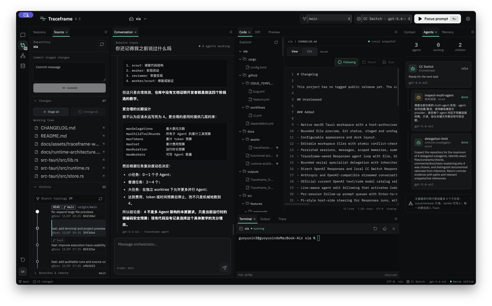

# Traceframe

Traceframe is a native Tauri coding workspace that keeps model activity, tool calls, file changes, Git state, context, and memory visible while a task runs.



_Traceframe 0.3 running as a native macOS application with a real local repository loaded. Preview and Terminal are additional draggable dock tabs in the current build._

## Current development build

| Status | Capability |
| --- | --- |
| Implemented | Native macOS shell; draggable and resizable persistent dock tabs with close, left-rail restore, and preset reset; authorized workspace picker; bounded file tree; editable UTF-8 file preview with conflict detection; Git status, diffs, branch topology, branch creation/switching, stage/unstage, commit, pull, and push; persisted sessions, messages, scoped memories, summaries, and runtime events |
| Implemented | GFM model replies and an execution timeline with numbered steps, per-step disclosures, and expand/collapse-all controls that pair model turns, commands, arguments, results, edited files, line ranges, and agent lifecycle evidence; Traceframe-owned Responses API agent loop with streamed output, cancellation, host-side in-run guidance, separate queued follow-up turns, bounded tools, timing, and usage |
| Implemented | Model-directed serial delegation to as many as four bounded child agents per run, with host-enforced read-only `scout`/`reviewer` and write-capable `worker` profiles, inherited provider/model/workspace scope, non-recursive child tools, and visible parent/child events |
| Implemented | Direct OpenAI Responses, local CC Switch Responses routing, Anthropic streaming, and OpenAI-compatible chat providers; provider health checks and model discovery |
| Implemented | Reversible AI file review with `Request approval` and `Full access` modes; durable per-file diffs and decisions; inline MCP tool approval; local `SKILL.md` discovery; remote MCP health checks, tool allowlists, and approval policy configuration |
| Implemented | A real PTY terminal for the authorized workspace; local project start/stop/restart; loopback-only project preview; element selection that adds structured HTML context to the active conversation draft; and explicit terminal staging for preview and deployment commands |
| Planned | Isolated child worktrees, conflict-aware merge queues, per-agent configuration, authoritative context budgets, production deployment adapters, and hosted preview URLs |

Traceframe does not launch Codex or delegate its coding loop to a Codex process. The Rust host sends requests to the selected model provider and executes Traceframe's own tools.

## Models and authentication

### CC Switch

The built-in CC Switch provider connects only to a loopback endpoint, by default `http://127.0.0.1:15721/v1`.

- Health: `GET /health`
- Model discovery: `GET /v1/models`
- Agent runs: `POST /v1/responses`

Traceframe sends no client `Authorization` header to this route. CC Switch owns its upstream credentials and injects them internally. Traceframe does not read the CC Switch database, configuration, keys, or tokens. If CC Switch advertises no models, Traceframe leaves the model field explicit rather than guessing an ID.

### Direct providers

For OpenAI and other providers, enter an endpoint, model, and API key. The endpoint and selected model are saved as local preferences. The API key remains in renderer memory for the current application process and must be entered again after restart; it is excluded from local storage, Traceframe's SQLite database, and the repository.

The OpenAI settings list the current general-purpose text and code models from the [official model catalog](https://developers.openai.com/api/docs/models). A successful authenticated `GET /v1/models` replaces that reference list with the models actually advertised to the current connection. Catalog presence is not proof of account access.

## Workspace

Every main surface is a dock tab and can be rearranged, resized, or closed. A closed panel appears in the left activity rail and returns to the tabset where the user last placed it, including after restart; older layouts fall back to its functional group. Code, diff, and output surfaces adapt to narrow dock widths without forcing the surrounding layout wider. Layouts persist locally and can be reset to the selected balanced, code, or conversation preset from Appearance settings.

| Area | Current behavior |
| --- | --- |
| Sessions | Create, search, archive, restore, and persist task history |
| Conversation | Render streamed and completed model replies as GitHub-flavored Markdown; inspect numbered model, command, file, and agent steps individually or expand/collapse the whole run; review file and MCP approvals in the run segment where they occurred, before later message cards; scroll back without forced auto-follow and use `Latest` to resume; send with Enter, add a line with Shift+Enter, guide an active Responses run, or manage queued follow-up turns |
| Code | Preview, edit, save, revert, detect conflicting external changes, and follow agent edits to the current file and changed line range without discarding local drafts |
| Diff | Inspect staged and unstaged changes for the selected file |
| Preview | Start, stop, or atomically restart a local development server; load a loopback URL; inspect project logs; select a rendered element; and append its selector, text, geometry, and bounded HTML to the current conversation draft for an AI-assisted edit |
| Terminal | Use a real interactive PTY rooted in the authorized workspace, including shell input, ANSI output, resizing, restart, clear, and close. Commands prepared by Preview are inserted only after an explicit click and are never executed until the user presses Enter |
| Source | Open Source Control from the left activity rail; refresh status; inspect staged and working-tree changes separately; view bounded commit topology with HEAD, local, remote, and tag refs; select a commit to inspect its identity, author, refs, and parents; create or switch branches; stage, unstage, commit, fast-forward pull, push or publish, and expand the latest 50 commit records |
| Output and trace | Inspect paired command output and per-run model, tool, file-change, usage, completion, failure, and cancellation evidence with global expand/collapse controls |
| Context and memory | Review deterministic session summaries and manage session, project, and global memory records |
| Agents | Follow the root agent and real delegated specialists, including their task, parent, model, progress state, and result |

## Approval and integration boundaries

### AI file changes

`Request approval` is a reversible post-edit review boundary. Before a mutating file tool runs, Traceframe records the affected file's content, existence, and Unix mode. Before a bounded command runs, it snapshots the repository inventory and versions needed to make detected changes reversible. After the model loop finishes, Traceframe persists the resulting per-file unified diffs, pauses the run before its final completion event, and presents file-by-file and whole-batch accept or reject controls.

Accepting keeps the current file. Rejecting restores the captured version, including deleting a file that the run created. A decision is refused if the file changed again after the AI edit, and a multi-file restore compensates already restored files if a later restore fails. Snapshots are limited to 8 MiB per file and 128 MiB per run. Approval batches, file status, and append-only decision audit records are stored in SQLite.

`Full access` uses the same journal and diff generation, but records an automatic policy acceptance and does not pause the run. It does not disable the workspace boundary, stale-write checks, command limits, or runtime trace.

### Skills and remote MCP

Settings can discover local `SKILL.md` files from selected folders, enable or disable them, and inject the enabled instructions into Responses runs. Discovery skips symlinks and build/vendor directories; a run loads at most 16 skills, 256 KiB per skill, and 512 KiB in total.

Remote MCP settings support HTTPS endpoints and loopback HTTP, optional in-memory bearer authorization, server labels, tool allowlists, enable/disable state, and an initialize health check. Authorization tokens are removed from persisted integration settings. MCP tools are supplied to the Traceframe-owned Responses loop; conversation-only provider adapters do not gain coding or MCP execution from this setting.

An MCP tool request that requires approval emits a run-scoped event, pauses that run, and appears inline with its server, tool name, and arguments. Allow or reject sends the decision to the native runtime, which emits the resolved event and returns the corresponding `mcp_approval_response` to the provider so the run can continue. Per-call approval remains required unless both the run is in `Full access` mode and that server is explicitly configured for `Full access`.

Filesystem operations stay behind the Rust host. The workspace bridge rejects traversal, symlink escapes, binary files, oversized writes, truncated previews, and stale overwrites. Agent commands run without a shell, with a program allowlist, output limits, and timeouts. The interactive terminal is intentionally a separate user-controlled PTY and does not expand the agent command allowlist. Preview pages pass through a short-lived loopback proxy fixed to the selected local origin; redirects cannot change origin, HTML injection is bounded, and the rendered page stays cross-origin from the Tauri host. These processes still run with the desktop user's operating-system permissions; a permission broker and stronger process isolation remain roadmap work.

Preview's deployment action defaults to staging `npx vercel --prod` in Terminal. This is a confirmation boundary, not an automatic deployment integration: Traceframe neither runs the command nor presses Enter, and provider-specific deployment status and hosted URL capture remain roadmap work.

Preview starts with `npm run dev`. Projects that use another development server can replace the program and arguments from Preview settings. The loopback proxy keeps scripts, styles, and module imports on one isolated preview origin, so frameworks do not need to relax CORS for Traceframe.

## Development

Requirements: Node.js 22+, Rust 1.84+, and the platform prerequisites for Tauri 2.

```bash
npm ci
npm run desktop:dev
```

Required checks:

```bash
npm run build
npm test
cargo fmt --manifest-path src-tauri/Cargo.toml --all -- --check
cargo test --locked --manifest-path src-tauri/Cargo.toml
npm run desktop:build
```

`npm run dev` starts a browser renderer with representative fallback data. Use `npm run desktop:dev` for native workspace, persistence, Git, editor, and runtime behavior.

See [runtime architecture](docs/runtime-architecture.md), [roadmap](ROADMAP.md), [security policy](SECURITY.md), and [contributing guide](CONTRIBUTING.md).

## Design credit

The interface was reviewed with [unslop](https://github.com/heydamir/unslop), created by Damir Sokolovsky, under CC BY 4.0.
