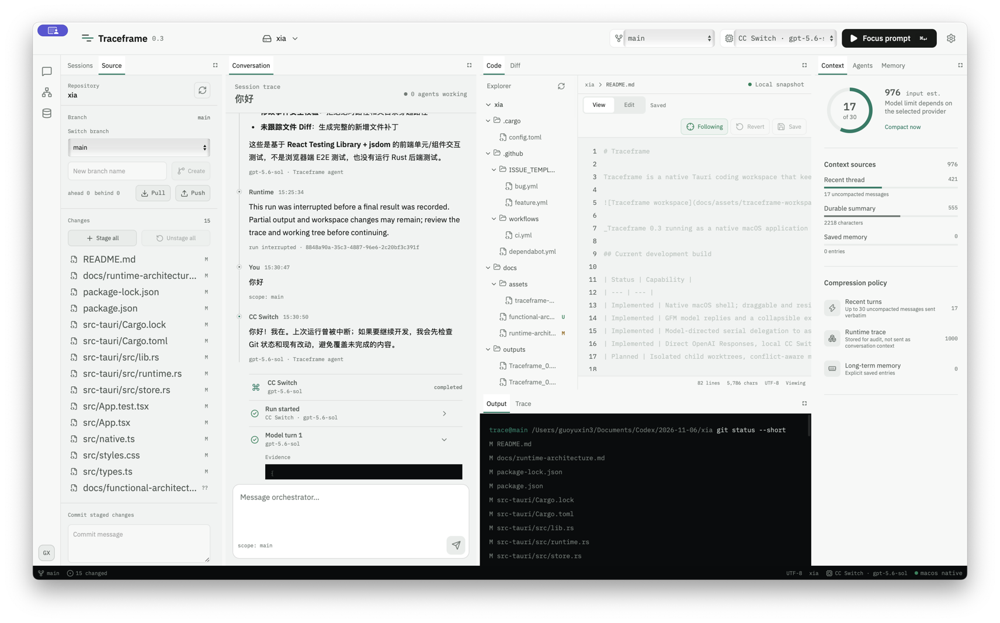

# Traceframe

[English](README.md) | 简体中文

Traceframe 是一款基于 Tauri 的原生智能编程工作台。在任务执行期间，它会把模型活动、工具调用、文件改动、Git 状态、上下文和记忆集中显示出来，让开发过程保持可见、可检查、可控制。



_Traceframe 0.3 以原生 macOS 应用运行，并已加载真实本地仓库。Preview 和 Terminal 在当前版本中也是可拖动的 Dock 标签页。_

## 下载与安装

请从 [GitHub Releases](https://github.com/guoyuxin33/traceframe/releases/latest) 下载当前公开版本。Traceframe 目前发布适用于 macOS 12 或更高版本、Apple Silicon（`arm64`）架构的 DMG 安装包。

1. 下载 `Traceframe_0.3.0_aarch64.dmg` 和对应的 `SHA256SUMS.txt`。
2. 可在下载目录运行 `shasum -a 256 -c SHA256SUMS.txt` 校验文件。
3. 打开 DMG，将 Traceframe 拖入“应用程序”文件夹。
4. 当前开发预览版尚未签名或公证。如果 macOS 在首次启动时阻止打开，请在“应用程序”中按住 Control 点击或右键点击 Traceframe，选择“打开”，再确认“打开”。不要关闭 Gatekeeper。

目前尚未发布 Windows、Linux 和 Intel Mac 安装包。满足下方开发环境要求的贡献者仍可从源码构建。

## 当前开发版本

| 状态 | 能力 |
| --- | --- |
| 已实现 | 原生 macOS 外壳；可拖动、缩放、关闭和持久化的 Dock 标签页；从左侧活动栏恢复已关闭面板；布局预设重置；经用户授权的工作区选择器；有边界的文件树；可编辑的 UTF-8 文件预览与冲突检测；Git 状态、差异、分支拓扑、分支新建/切换、暂存/取消暂存、提交、拉取和推送；持久化会话、消息、作用域记忆、摘要和运行事件 |
| 已实现 | GitHub Flavored Markdown 模型回复；带编号步骤的执行时间线；每一步可单独展开或折叠，也可全部展开/折叠；模型回合、命令、参数、结果、编辑文件、行范围和智能体生命周期证据相互关联；Traceframe 自有 Responses API 智能体循环支持流式输出、取消、运行中引导、独立排队的后续消息、有边界的工具、耗时和用量 |
| 已实现 | 模型可在单次运行中串行委派最多四个有边界的子智能体；宿主强制执行只读 `scout`/`reviewer` 和可写 `worker` 配置；子智能体继承提供商、模型和工作区范围，不能递归调用子智能体；父子事件均可见 |
| 已实现 | OpenAI Responses 直连、本地 CC Switch Responses 路由、Anthropic 流式接口和 OpenAI 兼容聊天提供商；提供商健康检查和模型发现 |
| 已实现 | 可撤销的 AI 文件审查，支持“请求批准”和“完全访问”模式；持久化逐文件差异与决定；行内 MCP 工具审批；本地 `SKILL.md` 发现；远程 MCP 健康检查、工具白名单和审批策略配置 |
| 已实现 | 工作区中的真实 PTY 终端；本地项目启动、停止和重启；仅限回环地址的项目预览；元素选择可把结构化 HTML 上下文加入当前对话草稿；预览和部署命令必须显式放入终端后由用户执行 |
| 计划中 | 隔离的子智能体工作树、冲突感知合并队列、逐智能体配置、权威上下文预算、生产部署适配器和托管预览地址 |

Traceframe 不会启动 Codex，也不会把编程循环委托给 Codex 进程。Rust 宿主直接向所选模型提供商发送请求，并执行 Traceframe 自己的工具。

## 模型与认证

### CC Switch

内置 CC Switch 提供商只连接回环地址，默认端点为 `http://127.0.0.1:15721/v1`。

- 健康检查：`GET /health`
- 模型发现：`GET /v1/models`
- 智能体运行：`POST /v1/responses`

Traceframe 不会向此路由发送客户端 `Authorization` 请求头。CC Switch 自行管理并注入上游凭据。Traceframe 不读取 CC Switch 的数据库、配置、密钥或令牌。如果 CC Switch 没有公布任何模型，Traceframe 会保留明确的模型输入框，而不会猜测模型 ID。

### 直连提供商

使用 OpenAI 或其他提供商时，需要输入端点、模型和 API 密钥。端点和所选模型会保存为本地偏好；API 密钥只保留在当前应用进程的渲染器内存中，重启后需要重新输入，不会写入本地存储、Traceframe SQLite 数据库或代码仓库。

OpenAI 设置页会列出[官方模型目录](https://developers.openai.com/api/docs/models)中的当前通用文本和编程模型。通过认证的 `GET /v1/models` 成功后，该列表会替换为当前连接实际公布的模型。出现在目录中并不代表当前账户一定有权使用。

## 工作台

所有主要界面都是 Dock 标签页，可移动、缩放或关闭。把标签拖到另一个标签组的中央可合并到该组，拖到上、右、下、左边缘会创建新的分区。关闭某个区域的最后一个标签后，空区域会立即移除，相邻面板会自动占用空间。关闭的面板会出现在左侧活动栏，点击后恢复到上次仍存在的标签组或相应功能组，重启应用后仍然有效。代码、差异和输出界面会适应较窄的 Dock 宽度，不会强行撑宽整体布局。布局保存在本地，也可在外观设置中重置为均衡、代码或对话预设。

| 区域 | 当前行为 |
| --- | --- |
| 会话 | 创建、搜索、归档、恢复并持久化任务历史 |
| 对话 | 以 GitHub Flavored Markdown 渲染流式和完成的回复；逐项查看带编号的模型、命令、文件和智能体步骤，或整体展开/折叠；文件和 MCP 审批显示在实际发生的运行片段中；向上滚动时不会被强制拉回底部，可用“最新”恢复跟随；Enter 发送、Shift+Enter 换行；可引导正在运行的 Responses 任务并管理排队的后续消息 |
| 代码 | 预览、编辑、保存、还原和检测外部修改冲突；AI 修改时自动打开当前文件并定位到变更行，不会丢弃本地草稿 |
| 差异 | 查看所选文件已暂存和未暂存的改动 |
| 预览 | 启动、停止或原子重启本地开发服务器；加载回环地址；检查项目日志；选择页面元素；把选择器、文本、几何信息和有边界的 HTML 加入当前对话草稿，用于 AI 辅助修改 |
| 终端 | 在已授权工作区中使用真实交互式 PTY，支持输入、ANSI 输出、自适应尺寸、重启、清屏和关闭。Preview 准备的命令只有点击后才会插入终端，并且在用户按 Enter 前不会执行 |
| 源代码管理 | 从左侧活动栏打开；刷新状态；分别查看暂存区和工作区改动；查看带 HEAD、本地、远程和标签引用的提交拓扑；选择提交查看身份、作者、引用和父提交；创建或切换分支；暂存、取消暂存、提交、快进拉取、推送或发布，并展开最近 50 条提交记录 |
| 输出与追踪 | 查看成对的命令输出，以及逐次运行的模型、工具、文件变更、用量、完成、失败和取消证据，并支持整体展开/折叠 |
| 上下文与记忆 | 查看确定性的会话摘要，管理会话、项目和全局记忆 |
| 智能体 | 跟踪根智能体和真实委派的子智能体，包括任务、父级、模型、进度状态和结果 |

## 审批与集成边界

### AI 文件改动

“请求批准”是可撤销的编辑后审查边界。可变更文件的工具运行前，Traceframe 会记录目标文件的内容、是否存在和 Unix 权限；有边界的命令运行前，会记录仓库清单和还原检测到的变更所需的版本。模型循环完成后，Traceframe 会持久化逐文件统一差异，在最终完成事件前暂停运行，并显示逐文件或整批接受/拒绝控件。

接受会保留当前文件。拒绝会恢复记录的版本，也会删除本次运行新建的文件。如果 AI 编辑后文件又被修改，Traceframe 会拒绝执行旧审查决定；多文件恢复时，如果后续文件失败，已经恢复的文件也会得到补偿。快照限制为单文件 8 MiB、单次运行总计 128 MiB。审批批次、文件状态和只追加的决定审计记录保存在 SQLite 中。

“完全访问”使用相同的日志和差异生成机制，但会记录策略自动接受，不暂停运行。它不会关闭工作区边界、过期写入检测、命令限制或运行追踪。

### Skills 与远程 MCP

设置页可以从指定文件夹发现本地 `SKILL.md`，启用或禁用 Skill，并把已启用的说明注入 Responses 运行。发现过程会跳过符号链接、构建目录和第三方依赖目录；单次运行最多加载 16 个 Skill，每个不超过 256 KiB，总计不超过 512 KiB。

远程 MCP 设置支持 HTTPS 端点和回环 HTTP、仅保存在内存中的 Bearer 认证、服务器标签、工具白名单、启用状态和初始化健康检查。认证令牌会从持久化集成设置中移除。MCP 工具会提供给 Traceframe 自有 Responses 循环；仅支持对话的提供商适配器不会因为此设置获得编程或 MCP 执行能力。

需要审批的 MCP 工具请求会发出本次运行范围内的事件并暂停该运行，在对话中显示服务器、工具名称和参数。允许或拒绝后，决定会发送到原生运行时，随后产生已处理事件，并向提供商返回对应的 `mcp_approval_response` 以继续运行。除非当前运行使用“完全访问”，并且该服务器也明确配置为“完全访问”，否则每次调用都需要批准。

文件系统操作始终由 Rust 宿主保护。工作区桥接层拒绝路径穿越、符号链接逃逸、二进制文件、超大写入、截断预览和过期覆盖。智能体命令不经过 shell，并受到程序白名单、输出限制和超时约束。交互式终端是用户单独控制的 PTY，不会扩大智能体命令白名单。预览页面通过短时回环代理加载，目标固定为所选本地源，重定向不能改变来源，HTML 注入有大小限制，渲染页面与 Tauri 宿主保持跨域。这些进程仍然拥有当前桌面用户的操作系统权限；权限代理和更强的进程隔离仍在路线图中。

Preview 的部署操作默认只会把 `npx vercel --prod` 放入 Terminal。这是确认边界，不是自动部署集成：Traceframe 不会执行命令，也不会代替用户按 Enter。提供商专用的部署状态和托管地址获取仍在规划中。

Preview 默认通过 `npm run dev` 启动项目。使用其他开发服务器的项目可以在 Preview 设置中更换程序和参数。回环代理会让脚本、样式和模块导入保持在同一个隔离预览源中，因此框架无需为 Traceframe 放宽 CORS。

## 开发

要求：Node.js 22+、Rust 1.84+，以及 Tauri 2 对当前平台要求的依赖。

```bash
npm ci
npm run desktop:dev
```

必要检查：

```bash
npm run build
npm test
cargo fmt --manifest-path src-tauri/Cargo.toml --all -- --check
cargo test --locked --manifest-path src-tauri/Cargo.toml
npm run desktop:build
```

`npm run dev` 启动带代表性回退数据的浏览器渲染器。使用 `npm run desktop:dev` 才能测试原生工作区、持久化、Git、编辑器和运行时行为。

另请参阅[运行时架构](docs/runtime-architecture.md)、[路线图](ROADMAP.md)、[安全策略](SECURITY.md)和[贡献指南](CONTRIBUTING.md)。这些文档目前以英文提供。

## 设计鸣谢

界面曾使用 [unslop](https://github.com/heydamir/unslop) 进行设计审查。unslop 由 Damir Sokolovsky 创建，采用 CC BY 4.0 许可。
